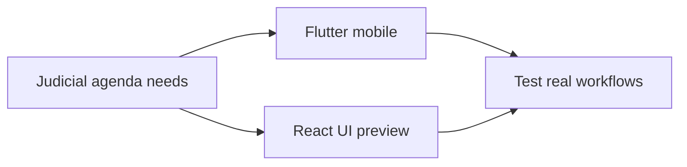

# الأجندة القضائية — Judicial Agenda Lab

**A development workspace combining a Flutter mobile codebase and a React/TypeScript UI preview.**

[Primary Flutter Agenda](https://github.com/matef-hub/agenda) · [Developer](https://github.com/matef-hub)

## Scope

This is an **experimental workspace**, not the confirmed production release. It contains both `lib/` (Flutter) and `src/` (Vite/React); they should be built and assessed separately. The intended experience is an Arabic RTL judicial diary for hearings, powers of attorney and office tasks.

| Interface | Stack | Local command |
|:--|:--|:--|
| Flutter | Dart + Flutter | `flutter pub get && flutter run` |
| UI preview | React + TypeScript + Vite | `npm install && npm run dev` |

## Quality notes

- Layout mockups are not evidence of finished persistence, authentication or synchronization.
- The previous README contained broken Markdown code fences and a placeholder clone URL; the actual repository address is `https://github.com/matef-hub/Agenda-new`.
- Use synthetic data for screenshots and design previews. Real client information belongs in protected systems.

**Maintained by [Mohamed Atef](https://github.com/matef-hub)** · Egyptian lawyer and legal-tech developer.
